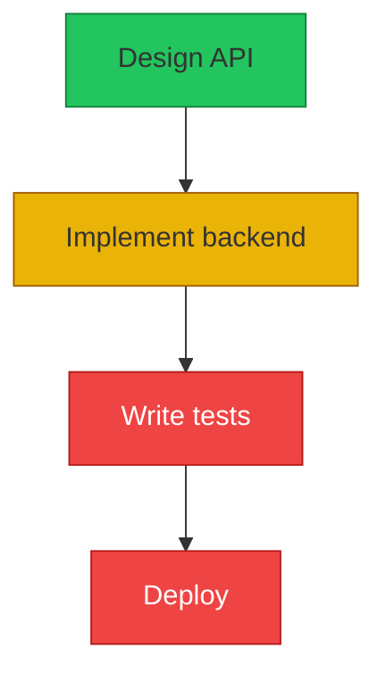

# ari-diagram-gh-todo

Track TODO items with dependencies as color-coded mermaid diagrams, posted as GitHub PR/issue comments.

## Color Scheme (status-based)

| Status | Color | Hex |
|--------|-------|-----|
| Unstarted / Blocked | Red | `#EF4444` |
| In Progress | Yellow | `#EAB308` |
| Done / Complete | Green | `#22C55E` |

When `~/.local/share/ari-diagram-mermaid/palette.mmd` exists, take the `red`, `yellow` and `green` `classDef` lines from it instead (see `/ari-diagram-mermaid` § Color Theme).

## Workflow

1. **Gather TODOs** from user — each item needs: name, status (unstarted/in-progress/done), dependencies
2. **Set up the session** — emit exactly this one Bash call; it prints the `diagram_file=` path to write to:
   ```zsh
   zsh $HOME/.claude/skills/ari-diagram-mermaid/bin/init.zsh --name todo-diagram
   ```
3. **Build mermaid `graph TD`** and write it to that `diagram_file`:
   - Line 1 is the `%%{init: …}%%` directive that opens `/ari-diagram-mermaid`'s color theme block, copied verbatim: it pins the theme and halos free-standing text, bake refuses the file without it, and GitHub renders it
   - Each TODO as a node, labeled with task name
   - Dependency arrows (`A --> B` means B depends on A)
   - Status-based classDefs and class assignments; every fill carries a text color that passes bake's contrast gate:
     ```mermaid
     classDef red fill:#EF4444,stroke:#B91C1C,color:#fff
     classDef yellow fill:#EAB308,stroke:#A16207,color:#333
     classDef green fill:#22C55E,stroke:#15803D,color:#333
     ```
4. **Bake** the file init printed:
   ```zsh
   zsh $HOME/.claude/skills/ari-diagram-mermaid/bin/bake /tmp/ari-diagram-mermaid/<timestamp>/todo-diagram.mmd
   ```
5. **Post as a GitHub comment** using `gh`. The comment MUST have this format:
   - An `## <Title>` header
   - A single sentence describing the diagram
   - A horizontal rule (`---`)
   - The mermaid fenced block

   ```bash
   gh issue comment <number> --body "$(cat <<'EOF'
   ## <Title>
   <One-sentence description of the diagram.>

   ---

   ```mermaid
   <diagram source>
   ```
   EOF
   )"
   ```

   Or for PRs, use `gh pr comment` with the same format.
   GitHub natively renders mermaid in comments — no image URL needed.
6. **Also provide** the mermaid.ink URL for embedding elsewhere (Google Docs, Slack, etc.)

## Example

For TODOs:
- "Design API" (done)
- "Implement backend" (in-progress, depends on Design API)
- "Write tests" (unstarted, depends on Implement backend)
- "Deploy" (unstarted, depends on Write tests)

### GitHub comment body:

```markdown
## API Launch Progress
4 tasks tracked — 1 done, 1 in progress, 2 remaining.

---


```
